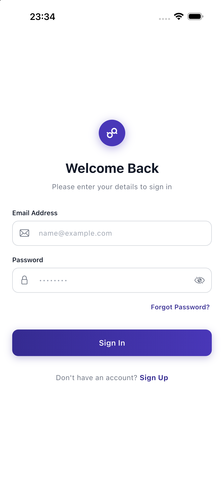
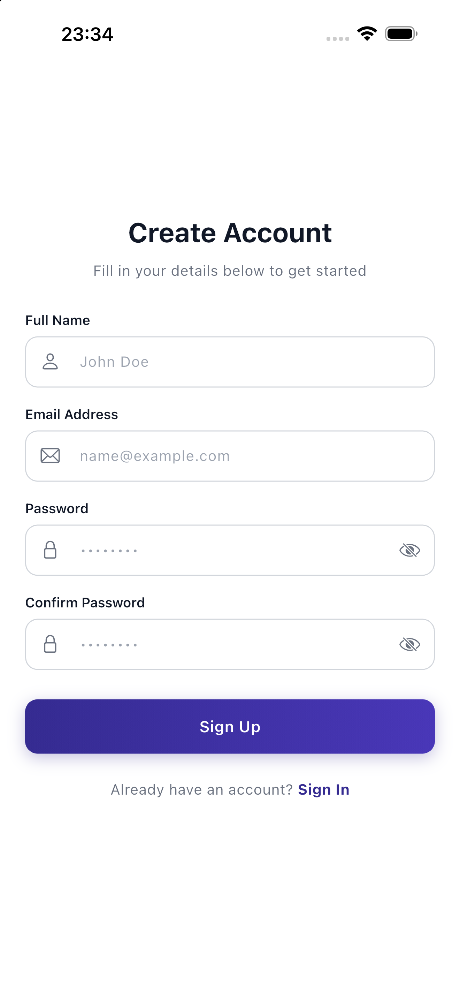
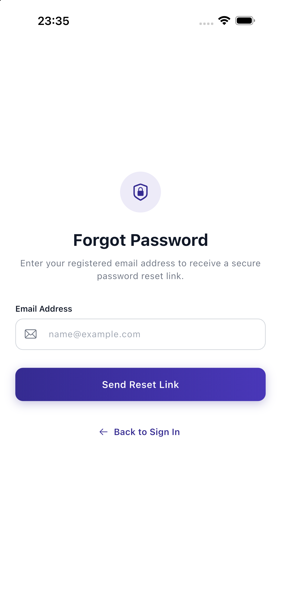
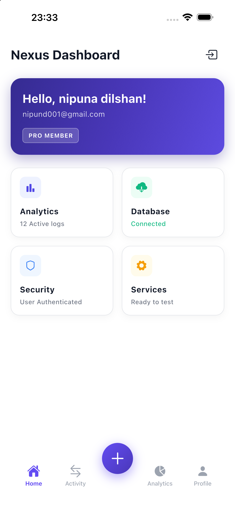

# Email Sign-In (Flutter)

A simple Flutter test project demonstrating Email & Password Authentication using **Firebase Auth** and **Provider**.

---

## Screenshots

| Sign In | Sign Up | Forgot Password | Dashboard |
| :---: | :---: | :---: | :---: |
|  |  |  |  |

---

## Features Tested

- User registration & login with email and password
- Display name update on registration
- Password reset email flow
- Session persistence across app restarts
- Client-side form validation

---

## Tech Stack

- **Flutter SDK**
- **Firebase Authentication** (`firebase_auth`)
- **State Management**: `provider`
- **Icons**: `cupertino_icons`

---

## How to Run

1. Install dependencies:
   ```bash
   flutter pub get
   ```

2. Run the application:
   ```bash
   flutter run
   ```
